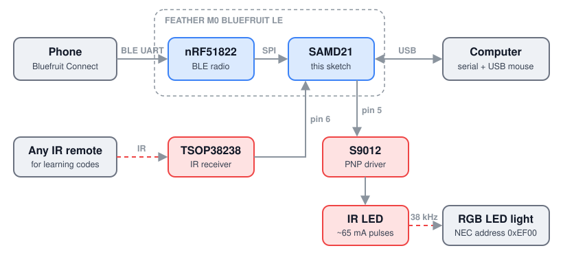

# Feather IR Remote

**A Bluetooth phone remote for IR-controlled lights, which doubles as a wireless USB mouse, all on one Adafruit Feather.**


Feather IR Remote turns an **Adafruit Feather M0 Bluefruit LE** into a universal IR blaster that you control from your phone. Tap the free **Adafruit Bluefruit Connect** app and the Feather sends the matching infrared code to your RGB LED light, with no original remote needed.

It also includes the tools for **finding** those codes: a brute-force **NEC scanner** for devices whose remote is lost, and an **IR decoder** that learns codes from any remote you do have. Press one button and the same phone screen becomes a **USB mouse** for the computer the Feather is plugged into.

---

## Contents

- [Features](#features)
- [How it works](#how-it-works)
- [Hardware](#hardware)
- [Wiring](#wiring)
- [Getting started](#getting-started)
- [Using it](#using-it)
- [Finding codes for a new device](#finding-codes-for-a-new-device)
- [Light codes](#light-codes)
- [Troubleshooting](#troubleshooting)
- [Engineering notes](#engineering-notes)
- [Project history](#project-history)
- [Roadmap](#roadmap)
- [License](#license)

---

## Features

- 📱 **Phone control over Bluetooth LE.** Works with the free Bluefruit Connect app (iOS/Android); no custom app needed.
- 🎮 **Two modes on one Control Pad.** **IR remote** ⇄ **USB mouse**, toggled with a single button.
- 💡 **Named commands for the light.** `on`, `off`, `red`, `blue`, `cycle`, `strobe`, `next`/`prev` color…
- 🔍 **NEC brute-force scanner.** Walks every command across common addresses to find codes for remotes you don't have.
- 🎓 **IR learning.** Decodes any supported remote protocol, then replays it or saves it to 8 slots.
- ⌨️ **Raw send.** `send AAAA CC` fires any NEC code for quick experiments.
- 🩺 **Built-in self-test.** `diag` checks the radio, the transistor wiring and the receiver electrically, with no multimeter needed.
- 🔌 **Same commands over USB serial.** Everything works from the Arduino Serial Monitor too.
- 💪 **Whole-room range.** The IR LED is driven through a transistor at ~65 mA pulses, about 10× what a microcontroller pin can supply.

---

## How it works

<p align="center">
  
</p>

The Feather M0 Bluefruit LE has two processors: a **SAMD21** that runs this sketch, and an **nRF51822** that handles Bluetooth and talks to the SAMD21 over SPI. The phone's Bluefruit Connect app sends either typed text (UART screen) or button packets (Control Pad screen). The sketch parses both. In IR mode it generates the 38 kHz NEC signal with [IRremote](https://github.com/Arduino-IRremote/Arduino-IRremote), and in mouse mode it sends USB HID mouse reports.

---

## Hardware

| Part | Notes |
|---|---|
| **Adafruit Feather M0 Bluefruit LE** | [Product #2995](https://www.adafruit.com/product/2995). The radio is built in. |
| **IR LED, 940 nm** | Any standard 5 mm IR LED |
| **S9012 PNP transistor** | Or any small PNP: 2N3906, BC557, S8550 |
| **1 kΩ resistor** | Transistor base |
| **27 Ω resistor** | IR LED current (22–47 Ω works) |
| **TSOP38238 or VS1838B IR receiver** | Optional; only for learning codes and `diag` |
| Phone with **Bluefruit Connect** | Free on [iOS](https://apps.apple.com/app/adafruit-bluefruit-le-connect/id830125974) and [Android](https://play.google.com/store/apps/details?id=com.adafruit.bluefruit.le.connect) |

---

## Wiring

### IR transmitter (PNP high-side switch)

```
                  S9012 (flat face toward you, legs down: E  B  C)

Feather 3V ──────────────────── E  (emitter, left)
Feather pin 5 ──── 1 kΩ ─────── B  (base, middle)
                                C  (collector, right) ── 27 Ω ── IR LED (+) long leg
                                                                IR LED (−) short leg ── GND
```

> ⚠️ **The emitter goes to 3V, not USB/5V.** The SAMD21's pins only swing to 3.3 V. With the emitter at 5 V, a HIGH pin would still leave the PNP 1.7 V "on", and the LED would never turn off.

> **Using an NPN instead?** Emitter → GND, pin 5 → 1 kΩ → base, USB 5 V → 33 Ω → LED → collector. Then delete `#define USE_ACTIVE_LOW_OUTPUT_FOR_SEND_PIN` from the sketch.

### IR receiver (optional)

| TSOP38238 pin (dome toward you) | Feather |
|---|---|
| OUT (left) | **pin 6** |
| GND (middle) | **GND** |
| VCC (right) | **3V** (not 5 V: the SAMD21 isn't 5 V tolerant) |

### Reserved pins

Pins **8, 7, 4** and the **SPI bus** (MOSI/MISO/SCK) belong to the on-board Bluetooth radio. Don't use them.

---

## Getting started

1. **Install the board and libraries.**
   - Board package: **Adafruit SAMD Boards** (Arduino IDE → Boards Manager)
   - Libraries: **IRremote** (4.7.x) and **Adafruit BluefruitLE nRF51** (Library Manager)

2. **Upload.** In the Arduino IDE, choose *Adafruit Feather M0* and upload `feather-ir-remote.ino`. Or use the CLI:

   ```bash
   arduino-cli compile --upload -p COM4 --fqbn adafruit:samd:adafruit_feather_m0 feather-ir-remote
   ```

   If the upload doesn't start, double-tap the Feather's reset button to enter the bootloader and try again.

3. **Connect.** Open **Bluefruit Connect** on your phone and connect to **Feather Remote**. Use **UART** to type commands, or **Controller → Control Pad** for buttons.

4. **Test.** Type `diag` in UART, then `on`.

---

## Using it

### Control Pad

**Button 3 switches modes.** The Feather's red LED blinks **once** for IR mode and **twice** for mouse mode. It always boots in IR mode.

| Button | 🔦 IR mode | 🖱️ Mouse mode |
|:---:|---|---|
| **3** | → switch to mouse | → switch to IR |
| **1** | start / resume scan | left click (hold to drag) |
| **2** | stop scan | right click |
| **4** | color cycle effect | cursor speed (LED blinks 1–3×) |
| **▲ / ▼** | next / previous color | move |
| **◀ / ▶** | scanner step back / next | move |

### UART commands

Type these in Bluefruit Connect → **UART** (line ending optional) or the Serial Monitor at **115200 baud**. They work in either mode.

| Command | What it does |
|---|---|
| `on` · `off` · `off2` | Light power |
| `red` `green` `blue` `white` `orange` `teal` `yellow` `purple` … | Set a color (`help` lists all) |
| `next` · `prev` | Step through colors |
| `cycle` · `strobe` | Effects |
| `p` | Start / pause the scanner |
| `n` · `b` · `r` | Scanner next / back / repeat (pauses) |
| `quick` | Try 10 common LED-strip power codes |
| `send CC` · `send AAAA CC` | Send any NEC code (hex; address defaults to `EF00`) |
| `learn` · `stop` | Turn the IR decoder on / off |
| `replay` | Resend the last learned code |
| `save N` · `play N` · `list` | Store / send / show learned codes (slots 1–8) |
| `mode` · `mode ir` · `mode mouse` | Switch modes |
| `diag` | Self-test |
| `help` | Command list |

---

## Finding codes for a new device

**Have the remote?** Use the decoder:

```
learn                 → decoder ON - point a remote at the receiver
(press a button)      → <- NEC addr=0xEF00 cmd=0x03 bits=32  (save N to keep)
save 1                → slot 1 = NEC addr=0xEF00 cmd=0x03 bits=32
stop
play 1                → -> NEC addr=0xEF00 cmd=0x03 ...
```

**Lost the remote?** Use the scanner. Point the IR LED at the device, press **1** on the Control Pad (or type `p`), and watch the device. Every 350 ms the scanner sends the next command (0x00 to 0xFF) and then moves on to the next common address (`0x00`, `0xEF00`, `0x80`, `0x01`). When the device reacts, press **2** to stop, then use **◀ / ▶** to step one code at a time and find the exact one. The phone shows each code as it's sent.

Add codes you find to the `LIGHT[]` table at the top of the sketch to give them names.

---

## Light codes

Codes for the RGB LED light this project was built for, all **NEC, address `0xEF00`**, found with the scanner:

| Cmd | Command | Cmd | Command |
|:---:|---|:---:|---|
| `0x02` | `off` | `0x0E` | `purple` |
| `0x03` | `on` | `0x0F` | `red2` |
| `0x04` | `red` | `0x10` | `yellow` |
| `0x05` | `green` | `0x11` | `blue3` |
| `0x06` | `blue` | `0x12` | `purplish` |
| `0x07` | `white` | `0x13` | `white2` (slow brighten) |
| `0x08` | `orange` | `0x14` | `yellow2` |
| `0x09` | `teal` | `0x15` | `blue4` |
| `0x0A` | `blue2` | `0x16` | `purple2` |
| `0x0B` | `cycle` (all colors) | `0x17` | `strobe` |
| `0x0C` | `yellowish` | | |
| `0x0D` | `blueish` | | |

`off2` (address `0x80`, cmd `0x02`) also turns it off. Many cheap 24-key RGB remotes use this same code set, so try it on yours.

---

## Troubleshooting

Start with **`diag`**:

```
--- diag ---
BLE radio: OK
pin 5 (PNP driver): S9012 base detected, emitter on 3V
pin 6 (receiver): receiver powered, output idling HIGH
IR loopback: ...
--- end diag ---
```

| Symptom | Likely cause |
|---|---|
| `pin 5: nothing detected` | Base resistor not on pin 5, transistor legs swapped, or emitter not on 3V |
| `pin 6: LOW` | Receiver missing, unpowered, or OUT not on pin 6 |
| IR LED glows constantly | Emitter on 5 V instead of 3V, or E and C swapped |
| Light doesn't respond | Look at the IR LED through a phone camera (rear camera) while sending: you should see a purple flicker. If it flickers, aim it more directly at the light. If not, check the LED's direction. |
| `IR loopback: no decode` | **Usually fine.** The Feather can't reliably decode its own signal while it's sending. If the receiver module's LED blinks on each send, the LED works. |
| Phone shows old name | Disconnect and reconnect in Bluefruit Connect |

---

## Engineering notes

A few problems came up while building this, and how they were solved:

- **PNP means active-low.** A PNP high-side switch turns on when its base is pulled LOW, the opposite of the usual NPN. The sketch defines IRremote's `USE_ACTIVE_LOW_OUTPUT_FOR_SEND_PIN` and drives pin 5 HIGH as the very first line of `setup()`, so the LED can't glow during boot.
- **Checking the wiring with no extra parts.** `diag` switches pin 5 to an input with the internal pull-down enabled. A correctly wired PNP pulls the pin HIGH through its base-emitter junction, and an empty pin reads LOW. Pin 6 is checked the same way: a powered TSOP holds its output HIGH when idle.
- **The packet checksum can look like a newline.** Every Control Pad packet ends in a checksum byte that can be *any* value, including `\n` or `0x00`. An early version parsed it as text, which occasionally dropped a packet. In mouse mode, a dropped *release* would leave the cursor moving forever. The parser now skips exactly one checksum byte after each packet.
- **Safe mode switching.** Changing modes always zeroes the cursor direction and releases the mouse buttons, so you can't leave the computer with a stuck click.
- **The decoder doesn't hear itself.** Every send briefly stops the receiver, so learning mode never records the Feather's own transmissions.
- **IRremote 4.7.1 quirk.** With `IR_SEND_PIN` defined at compile time, only `IrSender.begin(feedbackLedPin)` links. The older three-argument `begin()` compiles but fails at link time.

---

## Project history

This started as an **Arduino Mega 2560** sketch with an SPI OLED and four buttons, used to brute-force the NEC codes for an RGB LED light with no remote. The Mega worked, but it was tethered to the desk.

The port to the Feather dropped the OLED and the buttons and put the phone in their place, as both the display and the keypad. On the way it gained a transistor driver for room-wide range, IR learning, a self-test, and a second job as a Bluetooth-controlled USB mouse.

---

## Roadmap

- [ ] Optional SPI OLED status display (mode, last code sent)
- [ ] Save learned codes to flash so they survive a power cycle
- [ ] Raw-timing capture and replay for non-NEC remotes (AC units, etc.)
- [ ] Control the light over Wi-Fi from anywhere (ESP32 port)

---

## License

[MIT](LICENSE). Use it, change it, build on it.

Built with [IRremote](https://github.com/Arduino-IRremote/Arduino-IRremote) and the [Adafruit BluefruitLE nRF51](https://github.com/adafruit/Adafruit_BluefruitLE_nRF51) library.
